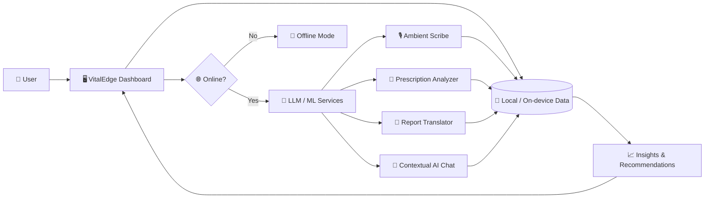

<div align="center">


### 🩺 Your health data. Your device. Your AI.

An offline-first personal health dashboard and clinical AI assistant that offers intelligent health insights, lifestyle recommendations, and symptom tracking using machine learning and LLMs.

<p>
  <a href="https://ai-personal-health11.vercel.app"></a>
  <a href="#-demo-video"></a>
</p>

<p>
  
  
  
  
  
  
</p>

</div>

---

## 📑 Table of Contents

- [About](#-about)
- [Key Features](#-key-features)
- [Screenshots](#-screenshots)
- [Demo Video](#-demo-video)
- [How It Works](#-how-it-works)
- [Tech Stack](#-tech-stack)
- [Project Structure](#-project-structure)
- [Getting Started](#-getting-started)
- [Usage Guide](#-usage-guide)
- [Privacy & Security](#-privacy--security)
- [Roadmap](#-roadmap)
- [Contributing](#-contributing)
- [Medical Disclaimer](#%EF%B8%8F-medical-disclaimer)
- [Author](#-author)

---

## 🌟 About

**VitalEdge** is an AI-powered personal health assistant built around one idea: *useful health intelligence should not depend on a perfect internet connection or on handing your data to someone else.*

It combines a clean personal health dashboard with a set of clinical-style AI tools, so you can understand your symptoms, prescriptions, and medical reports in plain language, and keep track of your health over time.

> 💡 **Why "Edge"?** The app is designed offline-first: the experience stays fast and usable at the edge (on your device), and AI features enhance it when available.

---

## ✨ Key Features

| | Feature | What it does |
|---|---|---|
| 🎙️ | **Ambient Scribe** | Listens to a consultation or your own voice notes and turns them into structured, readable notes. |
| 💊 | **Prescription Analyzer** | Breaks down a prescription into medicines, purpose, and general usage information in simple language. |
| 📄 | **Report Translator** | Converts complicated medical reports into plain-language explanations you can actually understand. |
| 💬 | **Contextual AI Chat** | A health chat assistant that is aware of your own dashboard data, so answers are relevant to you. |
| 📈 | **Symptom Tracking** | Log symptoms over time and spot patterns in your health. |
| 🥗 | **Lifestyle Recommendations** | Personalized, general wellness suggestions based on your tracked data. |
| 📴 | **Offline-First Dashboard** | Core dashboard stays usable without a connection. |

---

## 📸 Screenshots

> 🖼️ **Add your screenshots to `docs/screenshots/`** and keep the file names below (or edit the paths). Tip: take them from the [live app](https://ai-personal-health11.vercel.app) at 1440×900 for desktop and 390×844 for mobile.

<div align="center">

| Dashboard | Ambient Scribe |
|:---:|:---:|
|  |  |

| Prescription Analyzer | Report Translator |
|:---:|:---:|
|  |  |

| AI Chat | Mobile View |
|:---:|:---:|
|  |  |

</div>

---

## 🎬 Demo Video

> 🎥 Record a 1–2 minute walkthrough (screen recorder, Loom, or OBS), upload it, then use **one** of the options below.

**Option A – YouTube (recommended, clickable thumbnail):**

```md
[](https://www.youtube.com/watch?v=YOUR_VIDEO_ID)
```

**Option B – Direct upload to GitHub:** drag and drop an `.mp4` (under 10 MB) into the README editor on GitHub and it will embed a player automatically.

**Option C – Animated GIF preview:**

```md

```

---

## 🧠 How It Works



1. **Capture** – speak, upload a prescription, or upload a report.
2. **Understand** – the AI tools extract and explain what matters.
3. **Remember** – results are saved to your dashboard for tracking over time.
4. **Personalize** – the chat assistant and recommendations use your own data as context.

---

## 🛠️ Tech Stack

| Layer | Technology |
|---|---|
| Language | TypeScript |
| AI | Machine learning + Large Language Models (LLMs) |
| Hosting | Vercel |
| Approach | Offline-first, edge-oriented architecture |

> ✏️ *Add the exact framework and libraries you used (for example React/Next.js, Tailwind CSS, your LLM provider) to this table so the README matches your code precisely.*

---

## 📂 Project Structure

```text
ai-personal-health11/
├── edge-ai-healthcare-assistant/   # Main application source code
├── docs/                           # (add) screenshots, GIFs and diagrams
│   └── screenshots/
└── README.md
```

---

## 🚀 Getting Started

### Prerequisites

- [Node.js](https://nodejs.org/) 18 or newer
- npm (comes with Node.js) or yarn / pnpm
- An API key for your LLM provider (if the AI features need one)

### Installation

```bash
# 1. Clone the repository
git clone https://github.com/avirajgarg09-cloud/ai-personal-health11.git

# 2. Go into the app folder
cd ai-personal-health11/edge-ai-healthcare-assistant

# 3. Install dependencies
npm install

# 4. Add your environment variables
cp .env.example .env     # then fill in your keys

# 5. Start the development server
npm run dev
```

Then open the local URL shown in your terminal (usually `http://localhost:3000` or `http://localhost:5173`).

### Production build

```bash
npm run build
npm run preview   # or: npm start
```

> ⚠️ Commands above are the standard ones for a TypeScript web app. If your `package.json` uses different script names, update this section to match.

### 🔐 Environment Variables

| Variable | Description |
|---|---|
| `YOUR_LLM_API_KEY` | API key for the AI provider used by the assistant |

Never commit real keys. Keep `.env` in your `.gitignore`.

---

## 📖 Usage Guide

1. **Open the dashboard** to see your health overview.
2. **Ambient Scribe** → start a recording and get structured notes.
3. **Prescription Analyzer** → upload or paste a prescription to get a plain-language breakdown.
4. **Report Translator** → upload a medical report to get a simple explanation.
5. **AI Chat** → ask health questions with your own data as context.
6. **Track symptoms** regularly to unlock better insights.

---

## 🔒 Privacy & Security

- 🏠 **Offline-first design** keeps core data close to the user.
- 🚫 No health data should ever be hard-coded or committed to this repository.
- 🔑 API keys live in environment variables, never in source code.
- 🧾 Only share the data you are comfortable sending to an AI provider.

---

## 🗺️ Roadmap

- [x] Offline-first health dashboard
- [x] Ambient scribe
- [x] Prescription analyzer
- [x] Report translator
- [x] Contextual AI chat
- [ ] Wearable and fitness-device integration
- [ ] Medication reminders and notifications
- [ ] Multi-language support
- [ ] Exportable health summary (PDF)
- [ ] Progressive Web App (installable on phones)
- [ ] Automated tests and CI

---

## 🤝 Contributing

Contributions, issues, and feature requests are welcome!

1. Fork the project
2. Create your branch: `git checkout -b feature/amazing-feature`
3. Commit your changes: `git commit -m "Add amazing feature"`
4. Push to the branch: `git push origin feature/amazing-feature`
5. Open a Pull Request

---

## ⚕️ Medical Disclaimer

**VitalEdge is for informational and educational purposes only.** It is **not** a medical device and does **not** provide medical advice, diagnosis, or treatment. AI-generated output can be incomplete or wrong. Always consult a qualified healthcare professional about any medical condition, medication, or report. In an emergency, contact your local emergency services immediately.

---

## 👨‍💻 Author

<div align="center">

**Aviraj Garg**
B.Tech CSE (AI/ML) student · building in public

<a href="https://github.com/avirajgarg09-cloud"></a>
<a href="https://www.linkedin.com/in/aviraj-garg-6825b3435"></a>

⭐ If you found this project useful, please give it a star!

</div>


